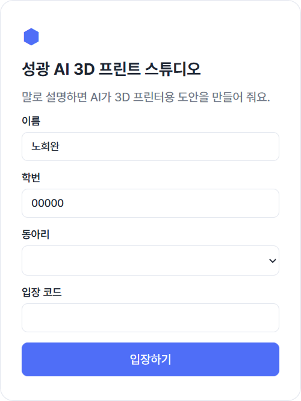
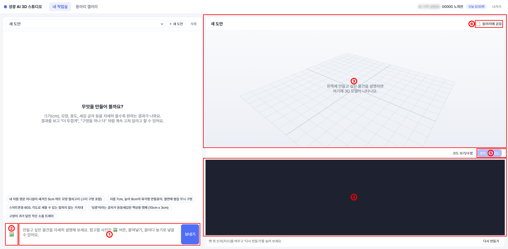
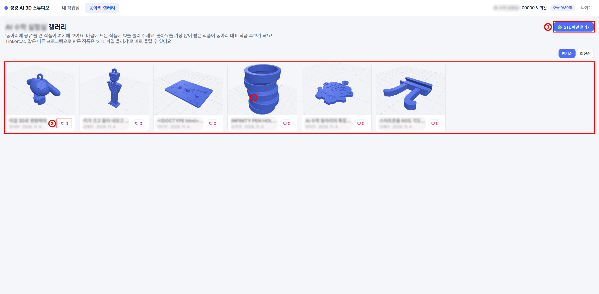

# 성광 AI 3D 프린트 스튜디오

성광여자고등학교 AI 동아리 학생들이 만들고 싶은 물건을 말로 설명하면, Claude가 3D 프린터용 도안을 만들어 주는 웹 서비스입니다.
만든 도안은 STL 파일로 받아 Bambu Lab P2S / X2D로 출력합니다.

## 동작 방식

```
학생 브라우저 ──프롬프트──▶ 서버(Node.js) ──API 키──▶ Claude (Opus 5.5)
      ▲                                                   │
      └──── OpenSCAD 코드 ◀────────────────────────────────┘
      │
      ├─ 브라우저 안에서 OpenSCAD(WASM)로 3D 모델 생성 → 3D 미리보기
      ├─ 렌더링 오류가 나면 오류 내용을 Claude에게 자동으로 보내서 수정 (최대 2회)
      └─ STL 다운로드 → Bambu Studio에서 열어 출력
```

- API 키는 **서버에만** 있고 학생 브라우저로는 절대 전달되지 않습니다.
- 3D 렌더링은 각 학생 PC에서 하므로 28명이 동시에 써도 서버 부담이 적습니다.
- 같은 동아리 학생끼리만 '동아리에 공유'한 작품과 사용한 프롬프트를 볼 수 있습니다.
- 프롬프트에 참고 사진을 3장까지 첨부할 수 있습니다.
- 공유된 작품에 좋아요를 누를 수 있고, 관리자 페이지에서 동아리별 순위를 보고 대표 작품을 정할 수 있습니다.
- Tinkercad 등 다른 프로그램으로 만든 STL 파일도 갤러리에 바로 올릴 수 있습니다. (파일 최대 50MB, 학생 1명당 5개)
- 선생님은 실시간 현황판에서 동아리별로 누가 접속해 있는지, 무엇을 만들고 있는지, 도움이 필요한 학생(렌더링 실패·오류·한도 도달)이 누구인지 볼 수 있습니다.

## 페이지 구성

### 로그인 페이지

>학생은 이름, 학번, 동아리, 입장 코드를 입력해 들어갑니다.



- **가입:** 별도 가입 절차 없이 처음 입장할 때 자동으로 등록됩니다.
- **다시 입장:** 등록된 이름, 학번, 동아리가 모두 맞아야 이전 작업을 이어서 할 수 있습니다.
- **입장 코드:** 선생님이 정한 공용 코드로, 외부인의 사용을 막습니다. 학생별 비밀번호는 없습니다.
- **로그인 유지:** 브라우저에 로그인 상태가 남으므로 공용 PC에서는 사용 후 '나가기'를 눌러야 합니다.

### 메인 페이지 (내 작업실)

>로그인하면 처음 보이는 화면으로, 왼쪽에서 AI와 대화하고 오른쪽에서 3D 모델을 확인합니다.



① **AI 도안 만들기:** 말로 설명하면 AI가 도안을 만들고, 대화로 계속 고칠 수 있습니다.

② **참고 이미지 첨부:** 사진이나 손그림을 보여 주며 요청할 수 있습니다.

③ **3D 미리보기:** 브라우저에서 모델을 돌려 보고 크기와 출력 가능 여부를 확인합니다.

④ **코드 직접 수정:** 코드의 치수를 바꿔 모델을 다시 만들 수 있습니다.

⑤ **STL 다운로드:** 완성한 도안을 받아 Bambu Studio에서 출력합니다.

⑥ **작품 공유:** 내 작업실에서 '동아리에 공유'를 켠 작품이 올라옵니다.

### 동아리 페이지 (동아리 갤러리)

>AI 수학 실험실, 메이크온, 크리에이티브 AI 동아리마다 따로 있는 작품 공유 공간입니다. 학생은 자기 동아리의 페이지만 볼 수 있습니다.



① **작품 보기:** 친구의 작품을 3D로 보고, 사용한 프롬프트를 확인하고, STL을 받을 수 있습니다.

② **좋아요:** 친구 작품에 좋아요를 누르면 가장 많이 받은 작품이 대표 작품 후보가 됩니다.

③ **STL 파일 올리기:** Tinkercad 등에서 만든 작품을 갤러리에 올립니다.

### 선생님 페이지(live.html/admin.html)

>관리자 비밀번호로 들어갑니다.

- **실시간 현황판:** 학생별 접속 상태와 작업 내용, 도움이 필요한 학생을 확인합니다.
- **관리자 페이지:** 사용량과 예상 비용을 보고, 동아리별 좋아요 순위로 대표 작품을 정합니다.

## 데이터베이스 (Supabase)

학생 정보, 도안, 좋아요 등 서비스 데이터는 Supabase(PostgreSQL)에 저장합니다. 로그인은 Supabase Auth를 쓰지 않고 서버에서 직접 처리하며, Supabase는 데이터베이스로만 사용합니다.

| 테이블 | 저장하는 내용 |
|---|---|
| `students` | 학생 정보, 하루 사용량, 토큰 사용량 |
| `sessions` | 로그인 상태 |
| `designs` | 도안 코드, AI 대화 내용, 미리보기 이미지, 공유 여부 |
| `likes` | 작품별 좋아요 |
| `design_files` | 학생이 직접 올린 STL 파일 |

- **접근 방식:** 모든 테이블에 RLS(행 수준 보안)를 켜고, 학생 브라우저가 아닌 서버만 `service_role` 키로 접근합니다.
- **테이블 만들기:** Supabase SQL Editor에서 `supabase/schema.sql`을 실행합니다.
- **연결 설정:** `.env`에 `SUPABASE_URL`과 `SUPABASE_SERVICE_ROLE_KEY`를 넣습니다. 비워 두면 로컬 테스트용 `data/db.json`에 저장합니다.

## 배포 (Render)

서비스는 Render에 배포해서 운영합니다. 학생들은 프로그램 설치 없이 브라우저에서 접속합니다.

- **배포 설정:** `render.yaml`에 설정이 들어 있어 Render의 Blueprint로 서비스를 만듭니다.
- **환경 변수:** API 키, Supabase 연결 값, 입장 코드, 관리자 비밀번호는 저장소가 아닌 Render에 등록합니다.
- **무료 요금제 참고:** 15분간 접속이 없으면 서버가 잠들고, 다음 첫 접속에 30초~1분이 걸립니다. 수업 전에 미리 한 번 접속해 두세요.

## 로컬 실행 방법

1. [Node.js](https://nodejs.org) 20.12 이상 설치
2. 패키지 설치
   ```bash
   npm install
   ```
3. `.env.example`을 복사해 `.env`를 만들고 값을 채웁니다.
   - `ANTHROPIC_API_KEY`: Claude 콘솔에서 발급한 키
   - `CLUBS`: 동아리 이름 3개 (쉼표로 구분). 학생이 가입한 뒤에 바꿀 때는 아래 [동아리 이름 바꾸기](#동아리-이름-바꾸기) 참고
   - `ACCESS_CODE`: 학생 입장 코드 (외부인이 API 크레딧을 쓰지 못하게 막는 용도)
   - `ADMIN_PASSWORD`: 관리자 페이지 비밀번호
4. 서버 실행
   ```bash
   npm start
   ```
5. 접속
   - 학생: `http://<서버 컴퓨터 IP>:3000`
   - 관리자: `http://<서버 컴퓨터 IP>:3000/admin.html` (학생별 사용량·예상 비용, 사용량 초기화)
   - 실시간 현황판: `http://<서버 컴퓨터 IP>:3000/live.html` (동아리별로 누가 접속해 있고 무엇을 만드는지, 도움이 필요한 학생, 활동 기록. 3초마다 새로고침)

## 데이터 관리

- **Supabase 사용 시:** 대시보드 **Table Editor**에서 학생(`students`)·도안(`designs`)·좋아요(`likes`)·직접 올린 STL 파일(`design_files`)을 보고 고치거나 지울 수 있습니다.
  - 학생 이름/동아리를 잘못 입력한 경우: `students` 표에서 직접 수정 (동아리를 옮길 때는 그 학생 도안(`designs`)의 `club`도 같이 바꿔야 갤러리에 맞게 나옵니다)
  - 학생을 지우면 그 학생의 도안과 로그인 정보도 함께 지워집니다.
- **로컬 테스트 시** (`SUPABASE_URL`을 비워 둔 경우): `data/db.json` 파일에 저장됩니다. (직접 올린 STL 파일은 `data/stl/` 폴더)

### 동아리 이름 바꾸기

학생과 도안에는 동아리 이름이 글자 그대로 저장됩니다. `CLUBS`만 바꾸면 이미 가입한 학생은 예전 이름으로 남아서 로그인할 수 없으니, 저장된 이름도 같이 바꿔 주세요.

1. 저장된 이름 바꾸기
   - **Supabase:** SQL Editor에서 아래 SQL의 `('예전 이름', '새 이름')`을 고쳐서 실행합니다. 마지막에 동아리별 학생·도안 수가 나오니 예전 이름이 남아 있지 않은지 확인하세요.
     ```sql
     with renames(old_name, new_name) as (values
       ('AI 동아리 1', 'AI 수학 실험실'),
       ('AI 동아리 2', '메이크온'),
       ('AI 동아리 3', '크리에이티브 AI')
     ), moved_students as (
       update public.students t set club = r.new_name from renames r where t.club = r.old_name
     )
     update public.designs t set club = r.new_name from renames r where t.club = r.old_name;

     select '학생' as 구분, club as 동아리, count(*) as 개수 from public.students group by club
     union all
     select '도안', club, count(*) from public.designs group by club
     order by 1, 2;
     ```
   - **로컬 테스트:** 서버를 끈 뒤에 `data/db.json`을 메모장으로 열어 `"club":"예전 이름"`을 `"club":"새 이름"`으로 모두 바꿉니다. (서버가 켜져 있으면 끌 때 예전 내용으로 다시 저장됩니다)
2. `CLUBS`를 새 이름으로 바꿉니다. (Render: **Environment**에서 수정 후 저장 / 로컬: `.env` 수정 후 서버 다시 시작)

## 폴더 구조

```
server.js            서버 (로그인, 도안 저장, Claude 스트리밍, 관리자 API)
lib/prompt.js        Claude에게 주는 3D 프린팅 설계 규칙 (시스템 프롬프트)
lib/store.js         로컬 테스트용 JSON 파일 저장소
lib/supabase-store.js  Supabase 저장소
lib/stl.js           직접 올린 STL 파일 검사
lib/live.js          실시간 현황판용 접속 상태·활동 기록 (서버 메모리)
supabase/schema.sql  Supabase 테이블 생성 SQL
render.yaml          Render 배포 설정
public/index.html    학생 화면
public/admin.html    관리자 화면
public/live.html     관리자 실시간 현황판
public/js/app.js     화면 동작
public/js/viewer.js  three.js 3D 미리보기
public/js/scad-worker.js  브라우저용 OpenSCAD(WASM) 렌더러
public/fonts/        한글 글꼴 (나눔고딕 Bold, SIL OFL)
```
